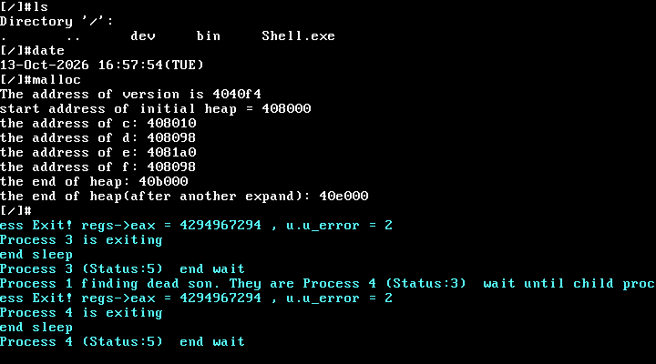

# UNIX V6++ 页表与位示图内存管理改造

操作系统课程项目，基于教学 UNIX V6++ 内核改造 x86 32 位分页结构、物理页位示图分配和进程地址空间管理，保留完整教学内核与用户程序供构建和运行验证。

## 改造范围

- [PageTable.h](src_V5/include/PageTable.h)：32 位页表项及 1024 项页表结构。
- [PageDirectory.cpp](src_V5/machine/PageDirectory.cpp)：页目录初始化与地址映射。
- [Allocator.cpp](src_V5/mm/Allocator.cpp)：保留原分配器，并增加 BitMapAllocator 的位图操作。
- [PageManager.cpp](src_V5/mm/PageManager.cpp)：页分配、释放与引用计数管理。
- [MemoryDescriptor.cpp](src_V5/proc/MemoryDescriptor.cpp)：进程地址空间及页表配合。
- [build_image.py](tools/v6pp-fs-edit-2022/build_image.py)：由内核、Shell 和用户程序生成文件系统镜像。

课程背景、实现细节和原实验记录见 [实验报告](docs/实验报告.md)。本仓库保留了基础内核，个人改造与教学基础代码应结合报告区分。

## 构建环境

原实验采用 Windows + MSYS2 **MinGW32**：GNU Make、32 位 GCC/G++、Binutils、NASM、Python，以及 QEMU i386。该内核使用 32 位 MinGW/PE 目标和 `_main1` 入口，不能直接替换为 64 位编译器或普通 Linux GCC。

仓库根目录保持 `src_V5/`、`targets/`、`tools/` 并列，以匹配 Makefile 相对路径。输出目录由构建准备步骤自动创建；编译产物和磁盘镜像不提交。

在 PowerShell 中，将路径改为实际 MSYS2 安装路径：

```powershell
$env:PATH = "C:\msys64\mingw32\bin;C:\msys64\usr\bin;" + $env:PATH
Set-Location src_V5
make all
```

构建输出：`targets/UNIXV6++/c.img`。构建按照目录顺序完成内核、运行库、Shell 与用户程序，请先使用串行 `make all`。

## QEMU 运行

在仓库根目录运行：

```powershell
qemu-system-i386 -m 32M -rtc base=localtime -boot c -drive file=targets/UNIXV6++/c.img,if=ide,index=0,media=disk,format=raw
```

进入 Shell 后可验证 `ls`、`date`、`malloc`、`forks` 等。注意 `fork` 样例只输出当前 PID，实际创建子进程的样例是 `forks`。需要暂停等待调试器时加 `-s -S`。`make qemu` 还带音频配置，具体后端与主机环境有关。



## 目录

```text
src_V5/        内核、头文件、运行库、Shell、用户程序及构建脚本
tools/         Python 镜像生成工具
targets/       构建输出位置（只保留目录占位文件）
docs/          实验报告、来源与本次验证记录
```

查看 [VALIDATION.md](docs/VALIDATION.md) 了解本次干净构建和启动检查的实际结果。来源见 [SOURCES.md](docs/SOURCES.md)。
